<!--
作者 / Author: Sahara
-->

# CCU Robotics Association

### 算法竞赛指南 · Algorithm Competition Guide

CCU 机器人协会 · 2026 —— Future

[**官网(Website) »**](https://ccu-robotics-association.github.io/) | [**GitHub 主页 »**](https://github.com/CCU-Robotics-Association) | [**竞赛指南(Guidelines) »**](../)

> **一  同  奋  进  前  行  ，  共  就  非  凡  之  事**

---

##  Overview | 内容介绍

本文介绍常见算法竞赛与 CSP 认证，包含赛制、参赛方式及作者的参赛体验，供协会成员了解和选择赛事

> [!NOTE]
> 下文包含作者的参赛经验、难度感受与历史赛制记录，章节顺序沿用原文的主观评价，不代表官方排名
> 赛事安排、报名门槛、奖项比例与参赛福利可能随年份、组别和赛站变化，请以当届官方通知为准

##  Contents | 阅读导航

- [ICPC、CCPC](#icpc-ccpc)
- [百度之星、蓝桥杯、天梯赛和 CACC](#astar-lanqiao-gplt-cacc)
- [CCF-CAT、CCSP 和码蹄杯](#cat-ccsp-matiji)
- [CSP 认证](#csp)

##  Team Contests | ICPC、CCPC

本节介绍面向大学生的团队程序设计竞赛
###  ICPC | 国际大学生程序设计竞赛

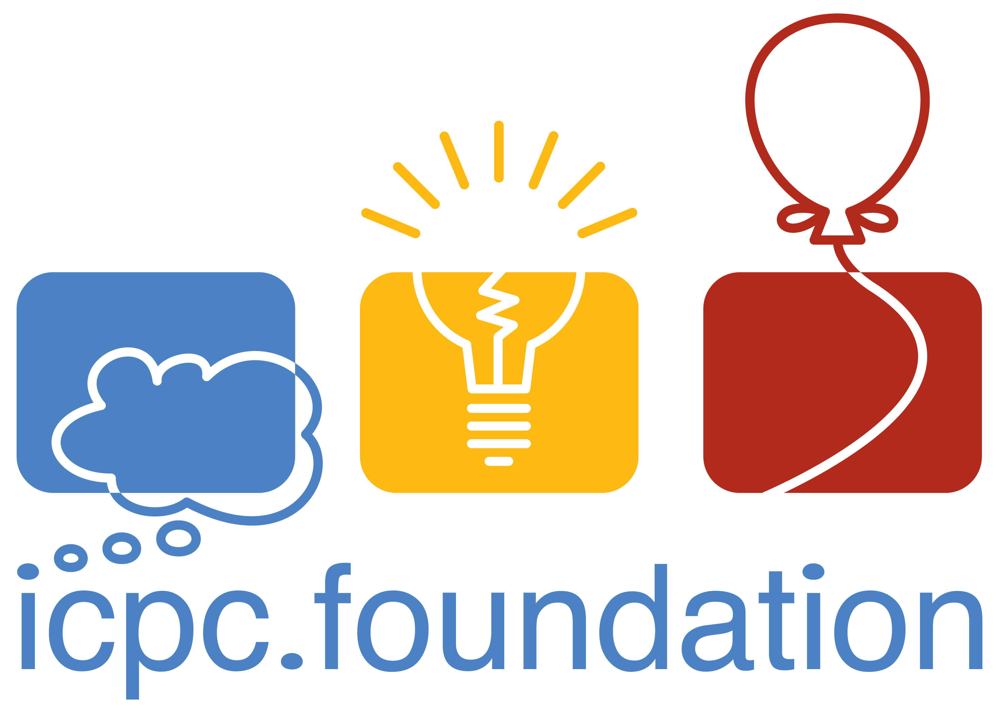

ICPC Global：[The ICPC International Collegiate Programming Contest](https://icpc.global/)

ICPC 北京总部：[ICPC北京总部](https://icpc.pku.edu.cn/)

**ICPC（International Collegiate Programming Contest）** 是面向大学生的国际程序设计竞赛。它既考算法，也考团队在有限时间、有限计算机资源下的分工与协作

赛制如下：

- 一共两天，第一天为签到+热身，热身 3 小时，主要是熟悉正式比赛环境，包括电脑、地点等等。第二天正式赛 5 小时。承办方提供餐券和午餐
- 三人参赛，一台电脑，题面类型可能为英文也可能为中文，11–13 道题目，分为**签到题**、**铜牌题**、**银牌题**和**金牌题**
- 题目范围涉及所有能涉及到的知识，包含数论、图论、博弈论、网络流等等等，难度极大
- 排名先按照解题数，解题数相同的情况下则按照罚时从小到大排名。比赛前 4 小时所有人能看到其他队伍提交的情况实时排名，最后 1 小时封榜，即看不到其他队伍的新提交情况；赛后滚榜，从后向前揭晓榜单
- 金牌为总正式队伍的前 10% 向上取整，银牌为金牌的两倍，铜牌为银牌的两倍。具体获奖比例以当届赛站规则为准

ICPC共有如下赛事类型，按照作者体验的难度排行为：

省赛 ≪ 邀请赛 ≈ 网络赛 ≤ 区域赛 < EC Final ≪ World Finals

省赛和邀请赛只需要按照承办方要求的申请即可获得名额，而区域赛则是按照网络赛排名和学校贡献（比如承办过省赛或者上一届承办过区域赛等等）来决定名额，当然还有一种名额类型为**外卡**，外卡需要按照承办方要求去进行申请（一个学校在一个赛季中大概率能获得一张外卡）。

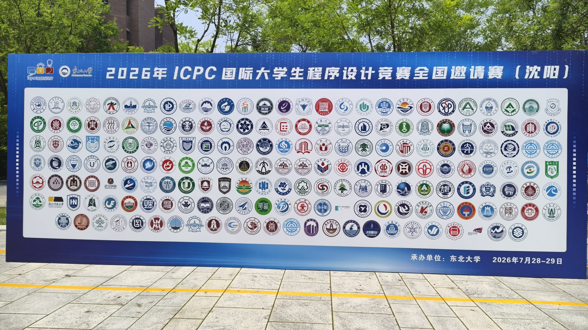

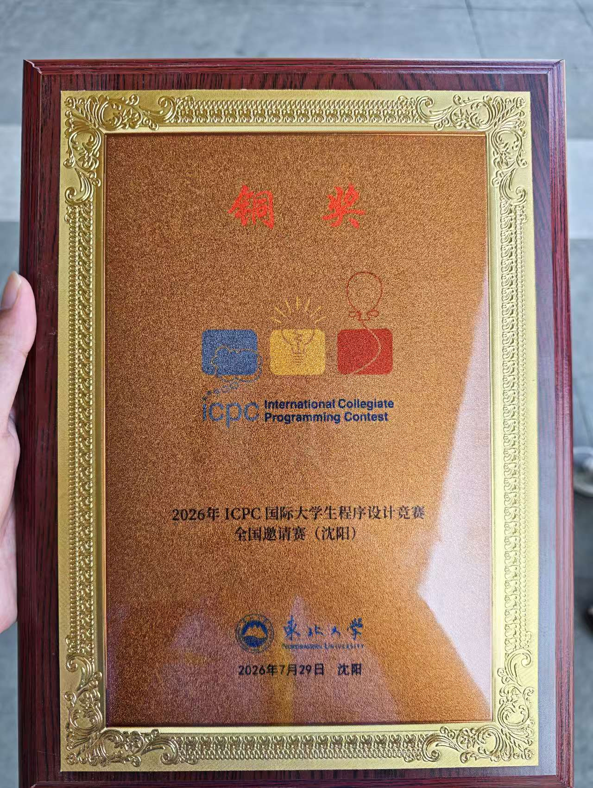

###  CCPC | 中国大学生程序设计竞赛

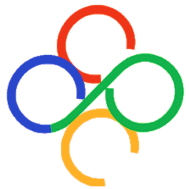

CCPC：[中国大学生程序设计竞赛(CCPC)-官网](https://ccpc.io/)

**CCPC（China Collegiate Programming Contest）** 由中国大学生程序设计竞赛组委会组织，是国内高校算法团队的重要参赛目标。它和 ICPC 有很多相似之处，这里只说不同点

- CCPC自2026年时更改了赛制，与ICPC不同的地方在于，只有在某道题目超过 50 支队伍通过后，这道题目才会解封。最后 1 小时解封所有题目

而CCPC的赛事类型相对较ICPC会少一些

省赛 ≪ 邀请赛 ≈ 网络赛 ≈ 女生赛 ≈ 高职赛 ≤ 区域赛 < 总决赛

省赛和邀请赛与ICPC相同，女生赛要求三人都是女生才能报名参赛（具体名额以当届通知为准），而这里区域赛则由CCPC组委会按照网络赛学校情况去分名额，去哪个赛站由组委会分好，然后可以跟其他学校进行交换

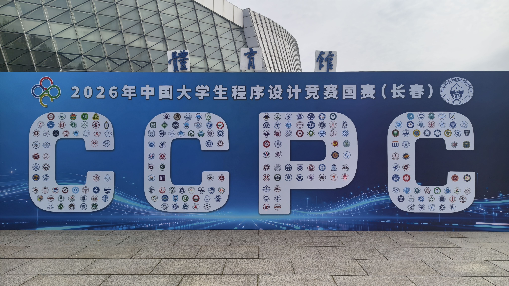

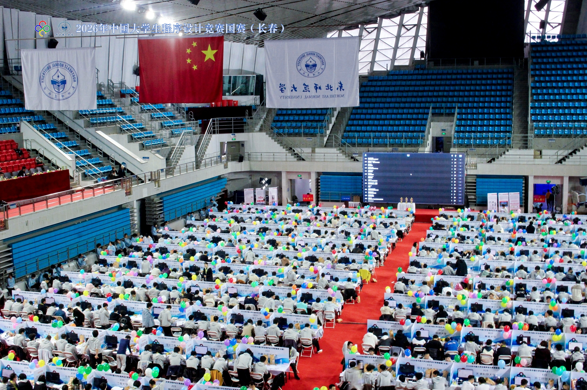

##  Algorithm Contests | 百度之星、蓝桥杯、天梯赛和 CACC

###  Baidu Star | 百度之星

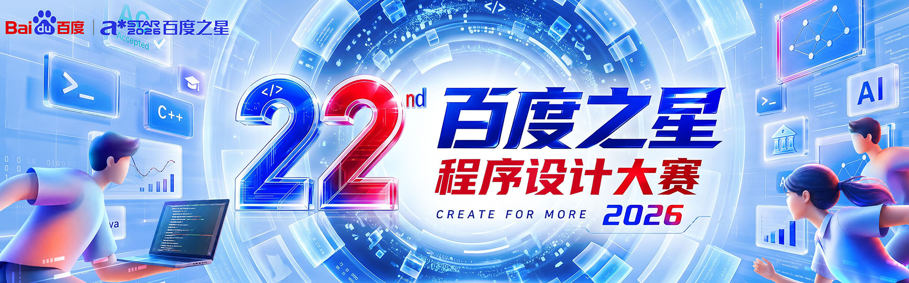

百度之星：[百度之星大赛](https://star.baidu.com/#/)

2026年的百度之星大赛为线上进行（双机位），使用码蹄集软件监考，2025年的决赛是线下进行，使用码蹄集的软件进行监考。百度之星是`IOI`赛制，即能看到所有人提交的情况，最后一小时封榜。与 `ICPC` 不同的是可以看到自己对所有测试点的情况。

10 道题左右，初赛 3 小时共三场，决赛 5 小时

获奖之后有奖金和奖牌以及奖品赠送，分为小星星组（小学生），高中组和大学组。（获奖难度稍高）

###  Lanqiao Cup | 蓝桥杯

蓝桥杯：[蓝桥杯大赛 — 全国大学生TMT行业赛事](https://dasai.lanqiao.cn/)

相对知名的比赛，但是由于办赛部分的不公平导致被看不起。获奖比例较高，因此省赛的证书认可度有限，但是由于参加国赛的条件是省一，所以国赛的含金量还有

蓝桥杯采用 `OI` 赛制（是高中生参加的信息学奥林匹克竞赛同样的赛制），一共 8 题左右前面两题必定是填空题，后面的才是编程题。省赛和决赛都是 5 小时

`OI` 赛制，没有实时排行和排名，提交之后看不见自己通过的情况，最后算分以最后一次提交为准。与 `ICPC` 赛制不同的地方在于，`ICPC` 赛制只有通过和不通过两种情况，`OI` 有部分分，即一道题分数为 $x$ ，通过了 10% 的用例，那么拿到 $0.1x$ 分。

决赛提供面包和一件衣服

###  GPLT | 团体程序设计天梯赛

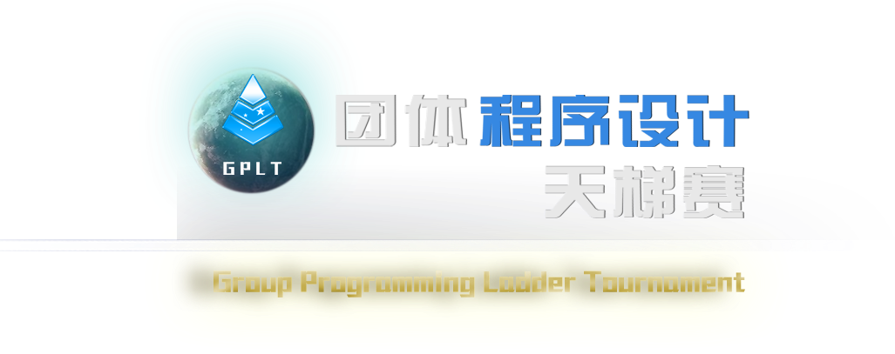

天梯赛：[竞赛规程](https://gplt.patest.cn/regulation)

天梯赛全国赛最大的要求就是 10 人参赛，如果是普及赛那么是随意的

普及赛为个人参赛，包含：判断对错题 10 道、单选题 5 道和编程题 9 道

而且按照天梯赛的赛制，就必须要求 10 人参赛，因为只有10个人都通过了基础所有题目后进阶题目才能有效

具体的可以看官网，因为我也没参加过这个比赛

###  CACC | CCF 算法能力大赛

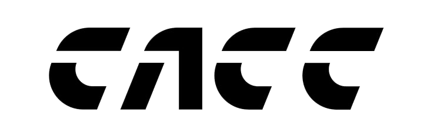

CACC：[CCF算法能力大赛](https://cacc.ccf.org.cn/index.html#/home)

最近出现的比赛，是CCF（中国计算机学会）举办的。采用 `IOI` 赛制。与百度之星不同的地方在于百度之星的 `IOI` 只有通过和不通过，但是它算部分分

省赛时长 5 小时。其中和传统算法题不同的地方在于，它有工程题目存在，即解决在项目工程上的一个问题，更多的会让你设计一个方法（运行耗时更短，内存更少的），然后算分

##  More Contests | CCF-CAT、CCSP 和码蹄杯

###  CCF-CAT | CCF 中国计算机应用技术大赛

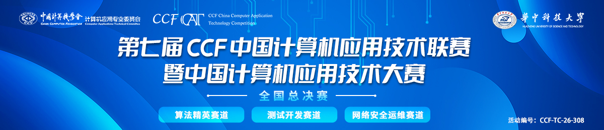

官网：[CCF中国计算机应用技术大赛](https://cat.ccf.org.cn/)

可通过官网或官方公众号查看当届通知

竞赛平台是赛氪网，采用 `ICPC` 赛制，Codeforces的gym里有往年的题

省赛和国赛都是 5 小时，传统算法题

比赛获奖有奖牌和奖金（不多，够把报名费赚回来还剩几百）

其实这个比赛是和CCF的一个会议一起举办的，叫 `NCCA`  计算机应用大会。参赛选手免费参会

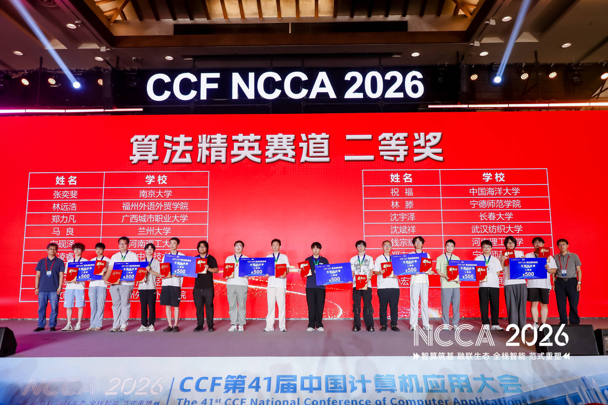

###  CCSP | CCF 大学生计算机系统与程序设计竞赛

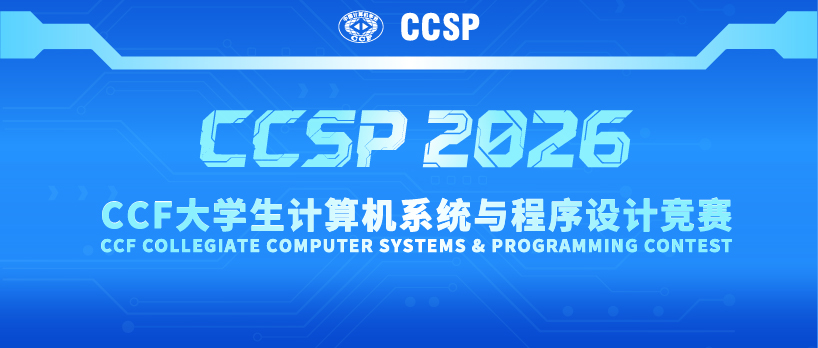

官网：[CCF CCSP 竞赛](https://ccsp.ccf.org.cn/)

这个比赛非常特殊，由CCF举办，并且要求CSP成绩 200 分以上才能报名，与CAT一样和CCF的一个会议一起，而且这个会议是CCF最重大的会议，`CNCC` 中国计算机大会。参赛选手免费可以参加这个会议（作者参会经验中，学生报名费约 1,500 元，其他参会者约 5,000 元；具体费用以当届通知为准）

`IOI` 赛制，算部分分

这个比赛还有特殊的地方在于比赛时长为 12 小时，9:00-21:00

题目 6 题左右，四题传统算法题，两题工程题（跟CACC又不同的是，这里是从头设计一个工程），非常考验学生的算法和程序设计的能力，所以强度高

获奖有奖牌和奖金，前几名有奖品

###  Matiji Cup | 码蹄杯

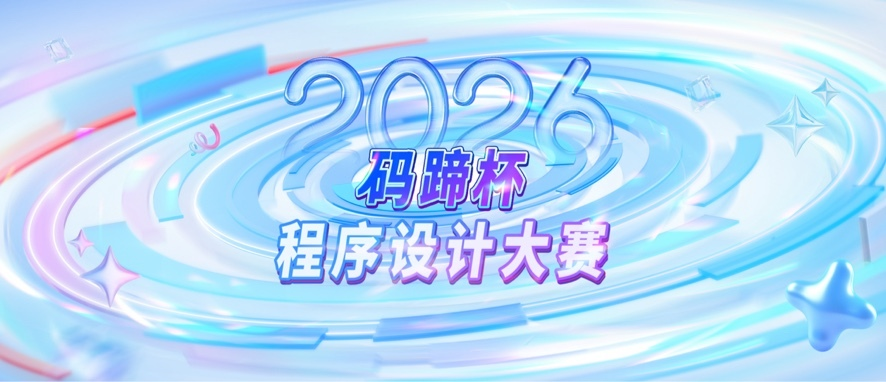

官网：[码蹄集](https://www.matiji.net/exam/)

比赛的所有东西和百度之星一模一样，难度比百度之星低，而且获奖较为容易。国奖给衣服、奖品和奖牌

##  CSP Certification | CSP 认证

官网：[CCF CSP认证](https://www.cspro.org/)

参赛体验：题目难度跨度较大，后半程挑战较强

5 小时，5 道题，前两题较为简单，第三题来个雷霆大模拟，第四题有难度（洛谷绿题和青题吧），第五题难度直线上升（洛谷蓝题和紫题吧）

跟CACC一样 `IOI` 赛制，测试点部分对得部分分

---

### CCU · ROBOTICS · ASSOCIATION

算法竞赛指南 | CRA Competition Guidelines

[**官网(Website)**](https://ccu-robotics-association.github.io/) · [**GitHub 主页**](https://github.com/CCU-Robotics-Association) · [**竞赛指南(Guidelines)**](../)

CCU Robotics Association

